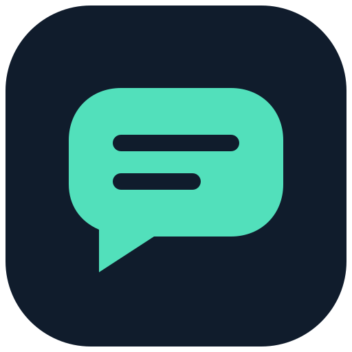

<p></p>

# WebChat AI

An OpenAI-compatible API powered by AI websites in your own Chrome browser.
Use the same providers and dashboard in a Windows desktop app or a self-hosted server.

```text
API client → WebChat AI → Chrome extension → AI website
                 ↑
             dashboard
```

Sign in to the websites in Chrome. The extension runs requests using those sessions;
clients use WebChat AI API keys. Website access, subscriptions and quotas still apply.
This project is independent of the supported websites and their vendors.

## Choose a mode

| | Desktop | Server |
| --- | --- | --- |
| Host | Electron app with local Node API | Node API in Docker or a Node process |
| Dashboard | Local window, no login | Browser, HTTP Basic authentication |
| Extension | **WebChat Extension** | **WebChat Server Extension** |
| Browser | Chrome on your computer | Chrome on the same or another computer |
| Connection | Localhost by default | Explicit server URL and server token |
| Updates | GitHub Releases, with download/install confirmation | Rebuild container and update extension separately |

The server does not launch a browser. Chrome must remain running and connected in
both modes. Desktop and Server extensions have different IDs and configuration.

## Desktop quick start

Download the Windows installer from [Releases](https://github.com/Bek2000u/webchat-ai/releases)
when a release is available, or build it from source below.

1. Start WebChat AI.
2. In **Settings → Chrome extension → Folder**, open the managed extension directory.
3. Open `chrome://extensions`, enable **Developer mode**, choose **Load unpacked**
   and select that directory.
4. Sign in to the AI websites you want to use. Check their connection on the
   **Chrome profiles** and **Providers** pages.
5. Create an API key on the **API keys** page for external clients.

The API listens on `http://127.0.0.1:8001`. Closing the window keeps the app in the
tray; **Quit** stops the API. See [Desktop builds and updates](docs/DESKTOP-RELEASE.md).

## Self-host with Docker Compose

```sh
git clone https://github.com/Bek2000u/webchat-ai.git
cd webchat-ai
cp .env.example .env
# Set SERVER_TOKEN to a long random value in .env before starting.
docker compose up -d --build
```

Open `http://127.0.0.1:8001` on the server. Dashboard username: `admin`; password:
your `SERVER_TOKEN`. For remote use, configure an HTTPS reverse proxy with WebSocket
support and set `PUBLIC_ORIGIN` in `.env`.

Load **WebChat Server Extension** from a release ZIP, or build it with
`npm run build:extension:server` and load `dist/extension-server/chrome-mv3`.
Enter the server URL and server token in its popup, then sign in to the websites.
It does not automatically connect to localhost.

Compose binds the HTTP port to the server's loopback interface and stores application
data in a persistent volume. [Server setup, configuration and backups](docs/server.md).

## Providers and capabilities

| Provider | Implemented operations | API text model |
| --- | --- | --- |
| ChatGPT Web | Text through the website UI | `chatgpt-web` |
| Gemini Web | Text through the website UI | `gemini-web` |
| Qwen Web | Text through the website UI | `qwen-web` |
| DeepSeek Web | Text through the website UI | `deepseek-web` |
| Google Flow | Image generation/editing and video | See `/v1/models` |
| Google Vids | Speech and voice catalog/previews | See `/v1/models` |

These adapters exist in the source; this table does not guarantee current website
availability. Website changes and account permissions can affect them.

- Text adapters use the site's default model. `auto` selects a connected text
  provider; configure its order in Settings or with `TEXT_PROVIDER_ORDER`.
- Thinking modes depend on the website and account. Unsupported options return an error.
- Text SSE delivers a completed website response; it is not live token streaming.
  Unknown token usage is `null`.
- Flow owns image/video operations. Images through the other website UIs are planned.
- Vids speech requires confirmed unlimited voiceover access. Static voice previews
  do not generate speech or require a connected provider account.
- The listed endpoints provide partial OpenAI compatibility. Tools, embeddings,
  transcription and unsupported attachment/sampling options are not implemented.

See [API and client examples](docs/API.md) and the [roadmap](PLAN.md).

## Use the API

Create a key in the dashboard, then use an OpenAI-compatible client with
`http://127.0.0.1:8001/v1` or your server's HTTPS origin followed by `/v1`.

```sh
export WEBCHAT_AI_API_KEY='your-api-key'
curl http://127.0.0.1:8001/v1/models \
  -H "Authorization: Bearer $WEBCHAT_AI_API_KEY"
```

Listing models does not submit a generation. Generation requests use your website
account and may consume credits or quotas.

```ts
import OpenAI from 'openai';

const client = new OpenAI({
  baseURL: 'http://127.0.0.1:8001/v1',
  apiKey: process.env.WEBCHAT_AI_API_KEY,
  maxRetries: 0,
});

const response = await client.chat.completions.create({
  model: 'chatgpt-web',
  messages: [{ role: 'user', content: 'Hello!' }],
});
console.log(response.choices[0]?.message.content);
```

An optional outbound [VideoForge connector](docs/API.md#videoforge-connector) can
forward requests through this same API. It is disabled until configured.

## Develop and build

Requirements: Node.js 24+, npm, and Chrome for extension/browser checks.

```sh
npm ci
npm run build
npm start
```

| Command | Purpose |
| --- | --- |
| `npm run dev` | Development API, serving the built dashboard |
| `npm run dev:web` | Vite dashboard development server |
| `npm run build:extension:dev` | Development extension in `dist/extension-dev/chrome-mv3-dev` |
| `npm run start:server` | Built API without Electron; desktop mode unless configured otherwise |
| `npm run typecheck` | TypeScript checks |
| `npm test` | Unit/integration tests with fixtures |
| `npm run build` | Server, dashboard, both extensions and Desktop shell |
| `npm run dist:win` | Local Windows NSIS installer; does not publish |

For API/UI development, load the development extension and build the dashboard with
`npm run build:web`, or use the separate Vite server. Provider browser tests and live
generation checks are separate from unit tests; see [CONTRIBUTING.md](CONTRIBUTING.md).

## Data and privacy

Source-mode data is stored in `data/`; Docker uses `/app/data` in the persistent
volume. Desktop retains the legacy `Chat2API` app-data directory for existing users.
`WEBCHAT_AI_DATA_DIR` overrides it; `CHAT2API_DATA_DIR` remains supported.

The data directory contains request history, generated files, configuration and
credentials. Website sessions stay in Chrome. These local stores are not an
encrypted vault; do not publish them or include them in issue attachments.
`data/`, temporary output, browser captures, `.env` files and build artifacts are
excluded from Git. Back up your data before upgrading or moving an installation.

Dashboard languages: Russian and Uzbek. Extension popup: English, Russian and Uzbek.
See [security guidance](SECURITY.md) and [architecture](ARCHITECTURE.md).

## License

[MIT](LICENSE). Dependencies retain their respective licenses.
